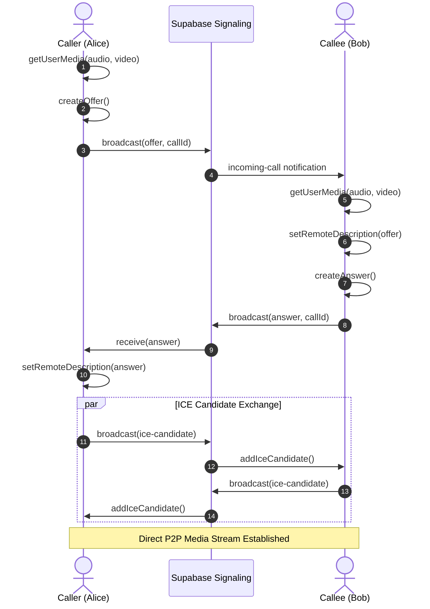

# 404 Founders — WebRTC Audio & Video Calling Architecture

## Overview
**404 Founders** implements direct browser-to-browser audio and video communication using the native **WebRTC API (`RTCPeerConnection`)** combined with **Supabase Realtime Broadcast** for signaling.

The calling layer is cleanly isolated in `lib/webrtc/callManager.ts` and `services/callService.ts`, allowing an external SFU (Selective Forwarding Unit like LiveKit or Janus) to be swapped in easily for production scaling beyond free tier limits.

---

## 1. Signaling & Connection Sequence



---

## 2. STUN Server Configuration
Free public STUN servers provided by Google are utilized:
```typescript
export const ICE_SERVERS: RTCConfiguration = {
  iceServers: [
    { urls: 'stun:stun.l.google.com:19302' },
    { urls: 'stun:stun1.l.google.com:19302' },
    { urls: 'stun:stun2.l.google.com:19302' },
    { urls: 'stun:stun3.l.google.com:19302' },
    { urls: 'stun:stun4.l.google.com:19302' },
  ],
};
```

---

## 3. Audio Ringtone Synthesis (Zero Asset Dependency)
Instead of bundling large audio files that may fail to download or encounter autoplay restrictions, ringtones and dial tones are generated dynamically via the **Web Audio API (`AudioContext`)**:
```typescript
const osc = this.ctx.createOscillator();
const gain = this.ctx.createGain();
osc.type = 'sine';
osc.frequency.setValueAtTime(440, this.ctx.currentTime); // Standard 440 Hz
gain.gain.setValueAtTime(0.1, this.ctx.currentTime);
gain.gain.exponentialRampToValueAtTime(0.001, this.ctx.currentTime + 1.2);
osc.connect(gain);
gain.connect(this.ctx.destination);
osc.start();
osc.stop(this.ctx.currentTime + 1.2);
```

---

## 4. Group Calling Strategy (College Demo Architecture)
For demonstrations with 4–6 participants:
- A peer-to-peer **mesh architecture** is used where each participant maintains an `RTCPeerConnection` with other room members.
- This requires zero external server costs, staying 100% within free-tier limits.
- The interface and event handlers are fully decoupled, so migrating to a dedicated SFU server in the future simply requires replacing the signaling dispatcher.
