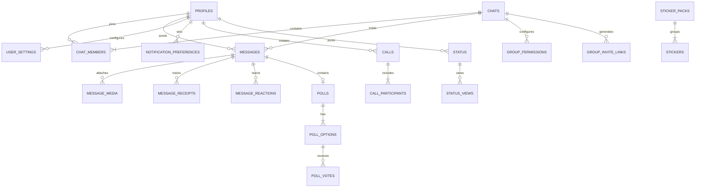

# 404 Founders — Database Architecture & Schema Reference

## Overview
The **404 Founders** database layer is designed for **PostgreSQL on Supabase**, using normalized tables, UUID primary keys, strict foreign key constraints, high-performance B-tree and GIN indexes, and comprehensive Row Level Security (RLS) policies.

---

## 1. Schema Diagram & Relationships



---

## 2. Table Specifications

### `profiles`
Stores user profile information synced automatically from `auth.users` via trigger.
- `id` (UUID, PK, references `auth.users.id` ON DELETE CASCADE)
- `full_name` (TEXT, NOT NULL)
- `username` (TEXT, UNIQUE, NOT NULL)
- `email` (TEXT, UNIQUE, NOT NULL)
- `bio` (TEXT)
- `avatar_url` (TEXT)
- `status_text` (TEXT)
- `is_admin` (BOOLEAN, DEFAULT FALSE)
- `created_at`, `updated_at` (TIMESTAMPTZ)

### `user_settings`
User privacy preferences and app configurations.
- `user_id` (UUID, PK, references `profiles.id`)
- `last_seen_visibility` ('everyone' | 'contacts' | 'nobody')
- `profile_photo_visibility` ('everyone' | 'contacts' | 'nobody')
- `about_visibility` ('everyone' | 'contacts' | 'nobody')
- `read_receipts` (BOOLEAN, DEFAULT TRUE)
- `typing_indicator` (BOOLEAN, DEFAULT TRUE)
- `group_add_permission` ('everyone' | 'contacts' | 'nobody')
- `call_permission` ('everyone' | 'contacts' | 'nobody')
- `notification_enabled` (BOOLEAN, DEFAULT TRUE)
- `email_notifications` (BOOLEAN, DEFAULT TRUE)
- `theme` ('light' | 'dark' | 'system')
- `language` (TEXT, DEFAULT 'en')

### `chats`
Contains 1-to-1 conversations and multi-user groups.
- `id` (UUID, PK)
- `is_group` (BOOLEAN, DEFAULT FALSE)
- `name` (TEXT)
- `description` (TEXT)
- `photo_url` (TEXT)
- `created_by` (UUID, references `profiles.id`)
- `created_at`, `updated_at` (TIMESTAMPTZ)

### `chat_members`
Association between users and conversations with membership state.
- `id` (UUID, PK)
- `chat_id` (UUID, references `chats.id`)
- `user_id` (UUID, references `profiles.id`)
- `role` ('admin' | 'member')
- `joined_at`, `last_read_at` (TIMESTAMPTZ)
- `is_muted` (BOOLEAN, DEFAULT FALSE)
- `mute_until` (TIMESTAMPTZ)
- `is_archived` (BOOLEAN, DEFAULT FALSE)
- `is_pinned` (BOOLEAN, DEFAULT FALSE)

### `messages`
Stores text, media references, system notices, locations, and poll containers.
- `id` (UUID, PK)
- `chat_id` (UUID, references `chats.id`)
- `sender_id` (UUID, references `profiles.id`)
- `message_type` ('text', 'image', 'video', 'audio', 'voice', 'document', 'sticker', 'gif', 'location', 'contact', 'poll', 'system')
- `text` (TEXT)
- `reply_to_message_id` (UUID, references `messages.id`)
- `forwarded_from_message_id` (UUID, references `messages.id`)
- `is_edited` (BOOLEAN, DEFAULT FALSE)
- `edited_at` (TIMESTAMPTZ)
- `is_deleted` (BOOLEAN, DEFAULT FALSE)
- `deleted_at` (TIMESTAMPTZ)
- `deleted_for_users` (UUID[])
- `created_at`, `updated_at` (TIMESTAMPTZ)

### `message_receipts`
Delivered and Read status for each participant per message.
- `id` (UUID, PK)
- `message_id` (UUID, references `messages.id`)
- `user_id` (UUID, references `profiles.id`)
- `delivered_at` (TIMESTAMPTZ)
- `read_at` (TIMESTAMPTZ)
- UNIQUE constraint on `(message_id, user_id)`

### `message_reactions`
Emoji reactions placed on messages.
- `id` (UUID, PK)
- `message_id` (UUID, references `messages.id`)
- `user_id` (UUID, references `profiles.id`)
- `emoji` (TEXT)
- `created_at` (TIMESTAMPTZ)
- UNIQUE constraint on `(message_id, user_id, emoji)`

### `calls`, `call_participants`, and `call_events`
Signaling, logging, and history of WebRTC calls.
- `calls.id` (UUID, PK)
- `calls.call_type` ('audio' | 'video')
- `calls.status` ('initiated', 'ringing', 'connected', 'ended', 'rejected', 'missed', 'failed')
- `calls.duration` (INT, in seconds)
- `calls.started_at`, `calls.ended_at` (TIMESTAMPTZ)

---

## 3. High Performance Indexes

```sql
CREATE INDEX idx_messages_chat_id ON public.messages(chat_id);
CREATE INDEX idx_messages_sender_id ON public.messages(sender_id);
CREATE INDEX idx_messages_chat_created ON public.messages(chat_id, created_at DESC);
CREATE INDEX idx_chat_members_composite ON public.chat_members(chat_id, user_id);
CREATE INDEX idx_receipts_message_id ON public.message_receipts(message_id);
CREATE INDEX idx_reactions_message_id ON public.message_reactions(message_id);
CREATE INDEX idx_notifications_user_id ON public.notifications(user_id, is_read, created_at DESC);
CREATE INDEX idx_status_expires_at ON public.status(expires_at);
CREATE INDEX idx_messages_text_search ON public.messages USING gin(to_tsvector('english', coalesce(text, '')));
```

---

## 4. Row Level Security (RLS) Matrix

| Table | Operation | Policy Logic |
|---|---|---|
| `profiles` | SELECT | Allowed for all authenticated users |
| `profiles` | UPDATE | Only own user ID (`auth.uid() = id`) |
| `chats` | SELECT | User must have entry in `chat_members` |
| `chats` | INSERT | Authenticated user (`created_by = auth.uid()`) |
| `messages` | SELECT | User must be in `chat_members` of message's chat |
| `messages` | INSERT | `auth.uid() = sender_id` AND user in `chat_members` |
| `messages` | UPDATE | Sender only (`auth.uid() = sender_id`) |
| `group_permissions` | UPDATE | Group admin only |
| `reported_users` | SELECT | `is_admin = true` |
