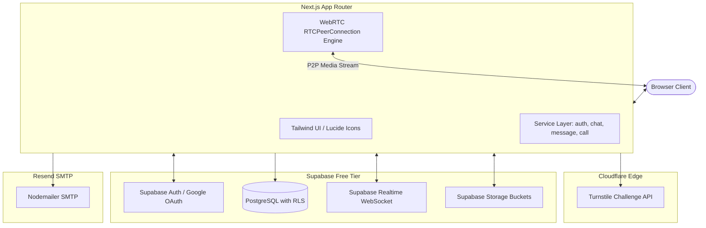

# 404 Founders — Real-Time Messaging & Calling Web Application

> **Production-Structured WhatsApp-Style Messaging Platform for College Capstone Project**  
> *Designed exclusively for 100% Free-Tier Cloud Infrastructure (Supabase, Resend SMTP, Cloudflare Turnstile, Vercel).*  
> **Strictly Zero Paid Services & Zero AI Dependencies.**

---

## 1. Project Overview

**404 Founders** is a full-featured real-time messaging, calling, and collaboration web application built for teams, students, and organizations. It provides a real-world, human-designed user interface modeled after modern communication tools like WhatsApp and Telegram.

### Key Capabilities
- **Authentication**: Email/Password signup, email verification link, Google OAuth (Supabase Auth), and Cloudflare Turnstile bot challenge.
- **Real-Time Communication**: Supabase Realtime WebSocket engine powering instant message delivery, live typing notifications, online presence badges, and read receipts (`✓` Sent, `✓✓` Delivered, `✓✓` Read).
- **Audio & Video Calling**: Browser-to-browser peer calling using native WebRTC (`RTCPeerConnection`), Google public STUN servers, synthesized audio ringtones, and mesh calling for groups.
- **Media & File Transfers**: Voice notes via browser MediaRecorder API with duration visualization, photo lightboxes, video streaming, document uploads (PDF, DOCX, ZIP), and custom sticker packs.
- **Collaboration Tools**: WhatsApp-style 24-hour status stories, live voting polls, location sharing (OpenStreetMap), contact sharing, and message replies/forwards/reactions/pins/stars.
- **Team & Group Governance**: Granular admin permissions, customizable invite links (`/join/:code`), and member management.
- **Security & Moderation**: PostgreSQL Row-Level Security (RLS) policies, abuse reporting, user blocking, and an Admin Dashboard.

---

## 2. Technology Stack

| Layer | Technology | Cost Tier |
|---|---|---|
| **Frontend Framework** | Next.js (App Router, React, TypeScript) | Open Source / Free |
| **Styling & UI** | Tailwind CSS, Lucide React Icons | Open Source / Free |
| **Database** | Supabase PostgreSQL with RLS & Triggers | Free Tier (500 MB) |
| **Authentication** | Supabase Auth + Google OAuth Provider | Free Tier (50,000 MAU) |
| **Realtime Engine** | Supabase Realtime (WebSocket channels) | Free Tier (200 concurrent connections) |
| **Media Storage** | Supabase Storage (S3-compatible) | Free Tier (1 GB) |
| **Email Service** | Resend SMTP & Nodemailer | Free Tier (3,000 emails/month) |
| **Bot Protection** | Cloudflare Turnstile | Free Tier (Unlimited) |
| **Audio/Video Calling** | WebRTC API + Google Public STUN | 100% Free |
| **Maps & Location** | OpenStreetMap / Leaflet Embeds | 100% Free |

---

## 3. Architecture Overview



---

## 4. Local Development Quickstart

### Prerequisites
- Node.js v18+ (tested on Node v24.13.0)
- npm v10+

### Step 1: Install Dependencies
```bash
npm install
```

### Step 2: Configure Environment Variables
Copy `.env.example` to `.env.local`:
```bash
cp .env.example .env.local
```
Fill in your Supabase project credentials (or test with the built-in demo evaluator accounts immediately).

### Step 3: Run the Test Suite
```bash
npm test
```
All 29 service and unit tests run in <100ms.

### Step 4: Start Development Server
```bash
npm run dev
```
Open [http://localhost:3000](http://localhost:3000) in your browser.

---

## 5. Supabase Setup Guide

1. Sign up for a free account at [supabase.com](https://supabase.com).
2. Create a new project named `404-founders-messenger`.
3. Go to the **SQL Editor** tab in the Supabase Dashboard.
4. Open `supabase/migrations/01_initial_schema.sql` from this repository, paste its contents into the SQL Editor, and click **Run**.
5. *(Optional)* Run `supabase/seed.sql` to populate 10 demo users, 5 private chats, 3 groups, and 50 messages.
6. Verify the following storage buckets exist under **Storage**:
   - `avatars` (Public)
   - `stickers` (Public)
   - `chat-media` (Authenticated)
   - `voice-messages` (Authenticated)
   - `documents` (Authenticated)
   - `status-media` (Authenticated)
7. Retrieve your **Project URL** and **anon public key** under Project Settings > API, and paste them into your `.env.local`:
   ```env
   NEXT_PUBLIC_SUPABASE_URL=https://your-project.supabase.co
   NEXT_PUBLIC_SUPABASE_ANON_KEY=your-anon-key
   SUPABASE_SERVICE_ROLE_KEY=your-service-role-key
   ```

---

## 6. Google OAuth Setup Guide

1. Open the [Google Cloud Console](https://console.cloud.google.com).
2. Create a new project and configure the **OAuth consent screen**.
3. Under **Credentials**, click **Create Credentials** > **OAuth client ID** > **Web application**.
4. In **Authorized redirect URIs**, add:
   ```
   https://<your-supabase-project-ref>.supabase.co/auth/v1/callback
   ```
5. Copy your **Client ID** and **Client Secret**.
6. In your Supabase Dashboard, navigate to **Authentication** > **Providers** > **Google**.
7. Enable the Google provider, paste the credentials, and save.

---

## 7. Resend SMTP Setup Guide

1. Create a free account at [resend.com](https://resend.com).
2. Generate an API Key under **API Keys** with "Sending access".
3. Configure your SMTP environment variables:
   ```env
   SMTP_HOST=smtp.resend.com
   SMTP_PORT=465
   SMTP_USER=resend
   SMTP_PASSWORD=re_your_api_key_here
   SMTP_FROM=onboarding@resend.dev
   SMTP_FROM_NAME=404 Founders Messenger
   ```
4. All 12 HTML transactional email templates are automatically rendered through `services/emailService.ts`.

---

## 8. Cloudflare Turnstile Setup Guide

1. Create a free account at [dash.cloudflare.com](https://dash.cloudflare.com).
2. Navigate to **Turnstile** > **Add Site**.
3. Set domain to `localhost` (and your Vercel deployment domain).
4. Select **Managed Challenge**.
5. Copy the Site Key and Secret Key into `.env.local`:
   ```env
   NEXT_PUBLIC_TURNSTILE_SITE_KEY=your_site_key
   TURNSTILE_SECRET_KEY=your_secret_key
   ```
   *(For testing without creating a Cloudflare account, the default test keys provided in `.env.example` always pass).*

---

## 9. WebRTC Calling Setup

Audio and video calls use the native browser WebRTC implementation:
- **No external paid servers are needed**. Google's free public STUN servers resolve NAT traversal:
  - `stun:stun.l.google.com:19302`
- **Signaling**: SDP offers, SDP answers, and ICE candidates are exchanged over Supabase Realtime broadcast channels (`call:<call_id>`).
- **Microphone & Camera**: Native HTML5 `navigator.mediaDevices.getUserMedia()`.
- **Ringtone**: Synthesized dynamically on the client via `AudioContext` without audio file loading issues.

---

## 10. Deployment to Vercel

1. Push this repository to GitHub or GitLab.
2. Go to [vercel.com](https://vercel.com) and import the repository.
3. In the **Environment Variables** step, add all the variables from your `.env.local`.
4. Click **Deploy**. Vercel will automatically build the Next.js App Router application and provide a production HTTPS URL.
5. Add your production Vercel domain to your Supabase Auth **Redirect URLs** list and Cloudflare Turnstile allowed domains.

---

## 11. Troubleshooting

| Issue | Cause | Solution |
|---|---|---|
| Camera / Mic blocked in calls | Browser permissions denied | Click the camera icon in browser address bar and choose "Allow". |
| Email verification link expired | Supabase default token timeout | Click "Resend verification email" on the verify page. |
| Message not sending | Offline or network disconnected | Check the top network banner; unsent messages can be retried once connection restores. |
| Storage upload error | File exceeds free tier size limit | Verify images are <10MB, videos <50MB, and docs <25MB. |

---

## 12. Technical Documentation Index

- [DATABASE.md](file:///c:/Users/HP/Downloads/404%20Founders/DATABASE.md): Schema definitions, triggers, indexes, and RLS policies.
- [API.md](file:///c:/Users/HP/Downloads/404%20Founders/API.md): Route Handlers, Turnstile verification, and service modules.
- [REALTIME.md](file:///c:/Users/HP/Downloads/404%20Founders/REALTIME.md): WebSocket channels, event catalog, and presence tracking.
- [CALLING.md](file:///c:/Users/HP/Downloads/404%20Founders/CALLING.md): WebRTC sequence, STUN configuration, and group calling.
- [SECURITY.md](file:///c:/Users/HP/Downloads/404%20Founders/SECURITY.md): Defense in depth, Turnstile, and secret protection.
