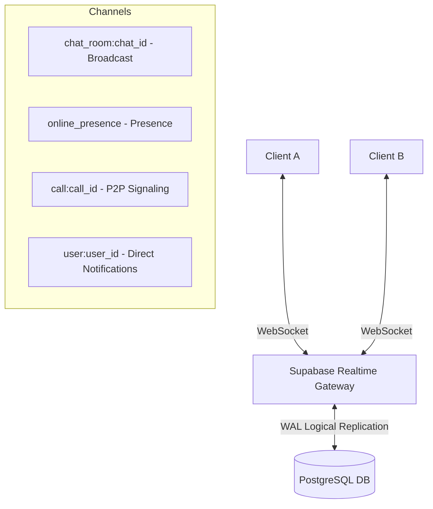

# 404 Founders — Realtime Architecture & WebSocket Protocols

## Overview
**404 Founders** uses **Supabase Realtime** over WebSockets to provide instantaneous communication, live presence, typing notifications, and WebRTC signaling without polling the database server.

---

## 1. Channels Architecture

---

## 2. Event Catalog

### Messaging Events (`chat_room:{chat_id}`)
- `message:new`
  - **Payload**: Full message object with sender metadata, attachments, and reply references.
  - **Trigger**: Fired immediately when a sender creates a message.
  - **Action**: Appended to recipient's local message feed and scrolls to bottom.
- `message:updated`
  - **Payload**: `{ id: string, text: string, is_edited: true, edited_at: string }`
  - **Trigger**: Fired when sender edits a message.
- `message:deleted`
  - **Payload**: `{ id: string, is_deleted: true }`
  - **Trigger**: Replaces local message bubble with *"This message was deleted"*.
- `message:delivered` / `message:read`
  - **Payload**: `{ message_id: string, user_id: string, read_at: string }`
  - **Trigger**: Updates status ticks to ✓✓ grey or ✓✓ sky blue.

### Ephemeral Indicators
- `typing:start`
  - **Payload**: `{ userId: string, username: string }`
  - **Trigger**: Fired when user types into textarea (debounced for 2 seconds).
  - **Action**: Displays *"typing..."* under user/chat header without database write.
- `typing:stop`
  - **Payload**: `{ userId: string }`
  - **Trigger**: Fired when typing stops or on message send.

### Presence Tracking (`online_presence`)
- Uses Supabase Realtime Presence API.
- Each connected client tracks `{ user_id, online_at }`.
- Clients listen on `presence:sync` to maintain an active array of `onlineUserIds`.
- Automatically emits offline event on tab close or network drop.

### WebRTC Signaling Events (`call:{call_id}`)
- `signal` with payload type `offer`: Sends SDP offer from caller to callee.
- `signal` with payload type `answer`: Sends SDP answer from callee to caller.
- `signal` with payload type `ice-candidate`: Exchanges ICE candidate IP and port routes.
- `signal` with payload type `call-ended`: Closes connection and releases media tracks.
